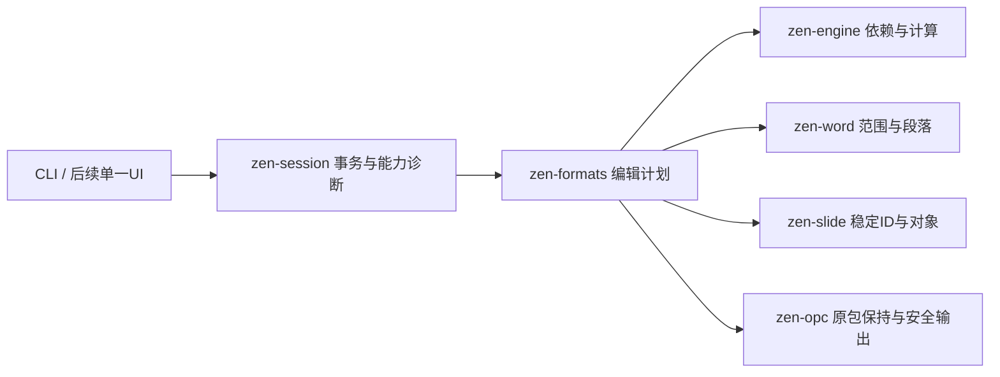

# ZenOffice 引擎开发计划暨只读任务书

编号：ZEN-ENGINE-v1.0。编制日期：2026-10-18。状态：本轮定稿后冻结；执行实况不写回本文件。任务负责人：本聊天开发代理；范围和新版本决定者：用户。

## 一、项目目标与交付范围

目标：形成可独立运行的Rust办公文件引擎，先交付三种格式的基本编辑、可靠保存和重开验证，再接一种UI。先完成表格数字会话闭环，逐步推进输入类型/结构/计算、文字与演示基本编辑。每个阶段以真实文件任务和拒绝边界验收；不以代码量、API名称数、资源数量或静态函数数计完成度。

范围内：XLSX数字与类型/公式/结构编辑和支持范围重算；DOCX范围/段落/样式、简单表格/图片关系；PPTX对象文字/几何、幻灯片管理；共同事务、诊断、包保持、原子输出和恢复。

后置或不承诺：任意Office文件等价兼容、出版级Word排版、复杂宏/嵌入对象编辑、任意数组/名称/外链、多个前端并行。未支持能力须明确拒绝或只读，不以保留字节冒充可编辑或正确显示。

## 二、编制依据与当前差距

1. 本仓库README、ENGINE_BACKLOG、WORKBOOK_SESSION_CONTRACT以及提交dffb11a的Windows Release/246项Rust测试基线；本轮没有重跑或新增Rust产品功能，该通过数不算本轮验收。
2. OFFICE_RESEARCH_BASELINE_2026-10-18.md：本机Office LTSC2024 ProPlus2024Volume，EXE版本16.0.17932.21056；8模块身份/资源、3份类型库、3个小型原生模块的单次静态观测。实际Office文档运行对照尚未开展，核心计算/排版算法尚未定位。
3. 本机DSHA1.3.0、REA6.4.0/Ghidra12.1.4；类型库采用REGKIND_NONE，不注册库。REA原始响应只在本地target/office_research保留，公开仓库只存独立研究摘要与复现脚本。

冻结时现况：E1；ENG-001设计已完成，ENG-002实现未开始。现有数字改写与重算接口可复用，尚无持久编辑会话和undo/redo；Word/Slides仍为受限已有文字编辑。RES-001为本轮首个静态调查任务；其DONE仅表示该任务的静态范围，不表示三件套逆向完成。

## 三、技术路线及实现形式

采用独立实现、证据可追溯、差异驱动研究。先对照外部可观察行为/文件结构，再为实际差异选择REA函数/引用链调查。没有具体问题不完整扫描大DLL；一次分析会话合并多个问题，结束关闭，保留未知项。

这是Zen的设计方案，不是对Office内部架构的还原结论。

- 共用会话：不可变有效工作帧、undo/redo游标、保存点、revision、dirty、源身份、历史预算和诊断；全部候选检查成功才提交。先支持已有数字，不提前造三种格式共用的复杂通用编辑枚举。
- Sheets：区分TypedValue输入、公式AST、显示格式和缓存；复用当前计算/依赖模块，定义结构变更的引用编辑计划。对日期体系、错误、数组/外链分别设准入；明确容差和支持范围。
- Writer：范围定位映射段落/运行与包内节点，维护关系和未知部件；逻辑动作作为事务撤销单元。内容编辑与排版验收分开，W-001字体/断行问题不以关闭兼容设置掩盖。
- Slides：稳定对象ID、顺序、关系和母版/版式分开；在有效编辑计划里增加/删除/重排，不能用下标代替持久身份。
- 交付形式：Rust库和稳定应用服务优先，CLI作为可重复任务入口；未来UI调用同一服务。Microsoft Office是本机参照宿主，不是Zen运行依赖；不把厂商代码/资源/反编译输出纳入公开产品。

接口设计的来源区分：本机类型库显示Range.Value2/Formula/Text、Word UndoRecord、PowerPoint SlideID等声明；公开文档补充其接口语义；事务帧和模块划分是独立设计。静态声明不能提升为运行结论。

## 四、阶段、依赖和执行顺序

| 里程碑 | 包含任务 | 放行条件 |
| --- | --- | --- |
| M0研究与设计 | RES-001、ENG-001 | 静态依据、未知清单和会话契约可追溯，不宣称产品新增能力 |
| M1数字会话闭环/E1 | ENG-002、ENG-003、RES-002、ENG-004 | 3份独立XLSX的多步编辑/撤销/另存/重开及Excel对照均留证据 |
| M2表格基本可用/E2–E3 | ENG-005、ENG-006 | 支持范围内类型/公式/结构编辑在3份业务工作簿闭环，未知依赖明确拒绝 |
| M3基础文字/E4 | RES-003、ENG-W01 | 3份DOCX内容、关系、保存重开和Word显示分别通过 |
| M4基础演示/E5 | RES-004、ENG-P01 | 3份5页PPTX对象编辑与幻灯片管理，内容/关系/宿主视觉分别通过 |
| M5引擎可用版/E6 | ENG-R01 | 每格式至少3个独立任务，包含新建/导入编辑，故障恢复与能力矩阵齐备 |
| M6后续UI/E7 | ENG-U01 | 在M5之后选择单一前端，UI不能绕过引擎能力门禁 |

默认下一实施项ENG-002；RES-002为M1宿主对照依赖，可先准备样本和观测脚本。Word/Slides研究可在明确问题或主线阻塞时推进，但不同时展开多个引擎实现。出现已支持路径的数据损失优先ENG-FIX。阶段依赖由执行者核对已有实况记录，校准脚本不冒称完整调度器。

周期沿用每60分钟复盘（有理由可在30–120分钟内调节既有heartbeat）；每周期通常选择一个有限实现/验收，任务可跨周期。不按日期强制宣告完成；未给出未经测量的总工期或完成率。每次先跟进前次活动句柄，避免重复导入或重复测试。

## 五、质量与验收标准

- 内容：明确每个样本的输入身份、操作序列、独立预期与支持边界；输出重开后再次核对。整数/字符串/标识符按精确值比较；浮点或布局差异的容差须在用例执行前写明，不能失败后改预期。
- 文件：源和旧输出受保护，未知部件按既定范围保持；锁定、源变化、损坏、预算和写失败返回可处理的诊断，不能静默成功。
- 状态：失败保持会话帧、历史、revision、dirty和保存点；支持操作的undo/redo及保存点有独立预期，宿主自动化Undo不作为Zen撤销的替代。
- 样本：RES-002/003/004各3份独立文件，每份计划3次宿主观测；样本数和重复数分开记录。重复观测不冒充独立样本，内部Rust通过不冒充宿主通过。
- 证据：提交、工具版本、命令、样本数、实测结果与未测范围齐备；引用旧基线要标明所属提交。没有Office运行或视觉检查就填NOT_RUN，不以资源或类型库声明代替。
- 回归：按影响范围运行测试；重跑全套需有代码变更或未解决问题。稳定的文档/治理工具修改不重复Rust246项全量回归。
- 证据分层：S=静态声明、F=函数/引用观测、R=运行观测、Z=Zen功能验收；每条论断注明层级和范围，没有自动升级关系。

## 六、逐任务实况校准和只读规则

本文件、tasks.json和lock.json在定稿时设Windows只读属性；lock.json记录前两者SHA256。它们是冻结标准，现况/偏差/进度单独存docs/task_runs和ENGINE_BACKLOG，不能把失败通过改任务书化解。只读属性与哈希是防误改措施，不宣称可抵抗拥有本机权限的人主动篡改；Git不保存Windows只读位，新检出需先核验锁定哈希再在本机设置只读属性。

每次任务/定时唤醒必须：

1. 读取官方额度及本地门禁；先运行 `python tools/taskbook/calibrate.py` 核验哈希/只读属性，再检查Git、前次实况和活动句柄。失败立即停止产品工作，记录偏差；不得自动解除只读或刷新基准哈希。
2. 从下列任务中选ID，核对依赖和当前阶段；用 `python tools/taskbook/calibrate.py --init ENG-002 --output docs/task_runs/<唯一轮次>.json` 创建独立实况记录。已有记录不覆盖，未关闭任务续写自身实况，不重复新建执行。
3. 执行前标明本轮子范围、命令、输入和预期。结束填写真实提交、开始/结束时间、逐条PASS/FAIL/NOT_RUN、样本数、证据、偏差、未测和下一步。跨周期未完成填PARTIAL，外部依赖阻断填BLOCKED，真实失败填FAILED；只有任务的冻结条件逐条PASS才能DONE。
4. `python tools/taskbook/calibrate.py --report <实况.json>` 与不带参数的基准核验均通过后才标记本轮收尾。脚本只检查哈希/结构/条件集合及声明，不证明证据内容真实，仍需检查真实日志和输出。不得由一个任务DONE推导整个阶段DONE。
5. 更新可变待办、循环记录和下一步；需要改变范围/标准时另建变更提案，列原因、证据、影响与候选新版本。原任务书保持，只在用户明确要求修订后新建版本；不能原地覆盖v1.0。常规实现细节可在不降低标准的前提下记录偏差，无需每次询问。

本轮首次RES-001调查在任务书形成之前开展；首份校准记录属于定稿后的回溯校准，不伪称此前已经过此门禁。后续任务在动作前校准。

## 七、风险、资源和停止条件

| 风险 | 对应措施 |
| --- | --- |
| 静态声明被误当行为 | 运行对照和未知项独立；先冻结输入和预期，再定位具体差异 |
| 核心DLL导入耗时与间接调用 | 告知数量级、同一会话批量查询、保存证据和未解链；超时不重发仍运行的操作 |
| 排版复杂度、字体和日期差异 | 分级支持；先内容闭环，字体/日期/区域设置随用例记录 |
| 数据损坏与原包丢失 | 候选验证、失败不变、原子输出、故障注入和原件哈希检查 |
| 任务书漂移 | 只读属性、SHA256、Git版本和每任务前后校验；偏差单独记录 |
| 额度/宿主/应用不可用 | 沿用本地门禁：未知/过期不开始新实质工作；剩余严格低于15%保存交接并暂停本聊天既有heartbeat及active goal，不自动恢复 |

关闭只限自己持有的分析会话和测试进程；不终止用户Office进程。未来宿主对照仅使用自制/授权副本和可确认身份的独立实例。未接通桌面外部硬中断，不声称全局强停。

## 八、任务定义（冻结）

以下逐项条件与同目录tasks.json共同冻结。实现任务的依赖不因研究先完成而消失。

### RES-001 — Office静态调查基线

依赖：无。
- **RES-001-C1**：固定8个已安装Office模块的版本、签名状态、大小和SHA256，取证前后逐个比较。
- **RES-001-C2**：读取Excel、Word、PowerPoint各1份类型库，保存对象/成员/调用种类；不注册、不启动Office。
- **RES-001-C3**：用REA保存8个模块资源证据；对XLCALL32、WINWORD、POWERPNT各1个原生会话保存概览、函数证据、关闭结果。
- **RES-001-C4**：报告区分静态声明、函数观测、推断与未知；保存复现命令、4项REA未知和证据包；不将原始厂商输出加入Git。

### ENG-001 — 共用工作簿会话设计

依赖：无。
- **ENG-001-C1**：核查已有读取、数字编辑、计算和保存接口，说明复用位置和未实现缺口。
- **ENG-001-C2**：定义帧、revision、dirty、undo/redo、保存点、拒绝原子性及内存预算。
- **ENG-001-C3**：列出ENG-002/003的独立预期与故障用例；设计完成不等于运行功能完成。

### ENG-002 — 数字会话与撤销重做

依赖：ENG-001。
- **ENG-002-C1**：新增zen-session或说明等价放置；复用ReadWorkbook/write_number_edit；同一会话对2个独立输入连续编辑，下游公式每步符合独立预期。
- **ENG-002-C2**：覆盖两步undo/redo、撤销后分支清除redo、相同值无变化；保存候选重读值和缓存一致。
- **ENG-002-C3**：非有限值、无权编辑格、预算耗尽及候选解析失败均保持当前帧、revision、历史、dirty和源字节；逐项故障记录。
- **ENG-002-C4**：至少2份独立自制XLSX运行上述适用用例；按提交运行相关Rust测试；无新UI。

### ENG-003 — 安全保存与会话CLI

依赖：ENG-002。
- **ENG-003-C1**：同一CLI会话连续编辑、撤销重做、另存、重开，复用应用服务，不复制编辑逻辑。
- **ENG-003-C2**：源外部变化、已有目标、输出独占锁、写失败分别拒绝并保持旧输出和工作帧；记录Windows平台结果。
- **ENG-003-C3**：成功保存后dirty=false，撤销偏离保存点为true，回到保存内容为false；失败不移动保存点。
- **ENG-003-C4**：同路径/别名/重解析路径的支持或明确拒绝有实测；并发检查不冒称原子compare-and-swap。

### RES-002 — Excel对照研究

依赖：RES-001。
- **RES-002-C1**：建立预算、订单、考勤3份独立自制工作簿，记录输入哈希、Office版本和逐步预期，不借旧通过数。
- **RES-002-C2**：仅在隔离工作副本中用本机Excel做同等输入、重算、另存和重开；每份3次运行，记录值、公式、缓存、错误和日期体系。
- **RES-002-C3**：明确自动化Undo的适用边界；数值相等/容差按每个用例预先规定，不能看到差异后改预期。
- **RES-002-C4**：对真实差异再选择EXCEL.EXE内函数专项；函数/引用、间接调用限制或未定位结果落证据，不以字符串冒充算法。

### ENG-004 — E1独立文件闭环验收

依赖：ENG-003、RES-002。
- **ENG-004-C1**：预算、订单、考勤3份XLSX完成Zen多步数字编辑、撤销重做、另存和重开。
- **ENG-004-C2**：与同等修改的Excel结果逐格比较支持范围内值、公式和缓存；不支持部分明确列出。
- **ENG-004-C3**：核对修改范围外部件及源文件保持；拒绝和锁定路径有独立样本；完整失败记录保留。
- **ENG-004-C4**：固定提交的相关Rust与Office宿主结果均可追溯；外部宿主未运行时只能标PARTIAL。

### ENG-005 — E2类型与公式编辑

依赖：ENG-004。
- **ENG-005-C1**：建立TypedValue和编辑准入表，覆盖空白、文本、布尔、数字、日期及普通公式；日期体系和错误值单列。
- **ENG-005-C2**：实现支持的类型/公式写回和跨表动态依赖更新；缓存与calc配置有独立预期；未知名称、数组、外链明确拒绝或只读。
- **ENG-005-C3**：3份业务XLSX分别包含类型切换、清空和公式替换；保存重开并与Excel同等修改对照。
- **ENG-005-C4**：失败不改变会话/原包/旧输出，撤销恢复数据和计算状态；相关Rust回归按提交记录。

### ENG-006 — E3结构及常用计算

依赖：ENG-005。
- **ENG-006-C1**：实现新建/重命名表、行列插删、复制填充与基础数值格式，变更引用通过专门编辑计划统一处理。
- **ENG-006-C2**：支持范围内跨表/固定行列/相对引用随结构变化正确；未支持的名称、数组、外链在变更前拒绝。
- **ENG-006-C3**：按3份业务任务需要扩展条件统计、查找和日期文本函数；不以函数名数量替代任务完成。
- **ENG-006-C4**：3份业务XLSX覆盖上述结构动作，Excel对照、保存重开、撤销和部件保持均留证据。

### RES-003 — Word范围与段落研究

依赖：RES-001。
- **RES-003-C1**：建立3份独立自制DOCX：跨运行文字、简单表格、图片与分节，输入和预期冻结。
- **RES-003-C2**：本机Word对同等范围/段落编辑、组合撤销、保存重开每份3次观测；内容、关系和显示分别记录。
- **RES-003-C3**：针对实际差异研究WWLIB或公开对象模型；页宽/字宽/塑形/断行不能由Range声明推导。
- **RES-003-C4**：保留W-001排版差异及未测复杂对象；报告复现命令和回滚，不改原文件兼容设置以追求一致。

### ENG-W01 — E4文字基本编辑

依赖：ENG-004、RES-003。
- **ENG-W01-C1**：在现有保包器上提供新建DOCX、范围文字及段落插删、字符/段落样式，不另造不兼容包写入器。
- **ENG-W01-C2**：支持简单表格、图片关系与分节，变更范围外未知部件保持；不支持编辑先明确拒绝。
- **ENG-W01-C3**：3份独立数页报告包含标题、正文、列表、表格和图片；保存重开内容、关系与Word宿主显示分别检查。
- **ENG-W01-C4**：会话拒绝原子性、撤销/重做、安全保存复用共同契约；近似预览不得标成Word等价排版。

### RES-004 — PowerPoint身份与对象研究

依赖：RES-001。
- **RES-004-C1**：建立3份独立5页PPTX，包含文本框、形状、图片、简单表格与不同版式；输入哈希固定。
- **RES-004-C2**：本机PowerPoint进行文字/几何编辑、增删重排、保存重开，每份3次，记录SlideID、Shape ID和关系变化。
- **RES-004-C3**：针对真实差异选择PPCORE函数专项，调用链和限制留证据；PPMain导入不证明对象编辑实现。
- **RES-004-C4**：按内容、包关系、稳定ID和宿主视觉分别报告，未知母版/版式对象的保持结果单列。

### ENG-P01 — E5演示基本编辑

依赖：ENG-W01、RES-004。
- **ENG-P01-C1**：统一查询幻灯片、文本框、形状、图片、表格，提供新建PPTX及文字/几何修改。
- **ENG-P01-C2**：幻灯片增删/重排维护稳定身份和包关系，不能用数组下标充当持久ID。
- **ENG-P01-C3**：3份独立5页简报完成任务后保存重开，母版、版式、未知对象保持，PowerPoint内容与视觉各自记录。
- **ENG-P01-C4**：共同事务、撤销和安全保存覆盖拒绝及失败路径；不支持的对象变更明确拒绝。

### ENG-R01 — E6引擎可用版

依赖：ENG-006、ENG-W01、ENG-P01。
- **ENG-R01-C1**：三种格式通过共同服务/CLI调用，能力矩阵分别列读取、保持、编辑、计算/排版及未支持项。
- **ENG-R01-C2**：每种格式至少3份独立真实任务，覆盖新建和导入编辑；固定提交上记录Rust与本机Office对照。
- **ENG-R01-C3**：损坏、资源限制、锁定、中断和恢复有回归证据；保存失败不损坏源或旧输出。
- **ENG-R01-C4**：公布安装、调用、诊断、恢复与复现资料；未通过项保留，达到本项后才重新评估UI。

### ENG-U01 — E7单一路径UI

依赖：ENG-R01。
- **ENG-U01-C1**：选定一种前端，所有编辑和保存经已验收的引擎服务，不能绕过准入诊断。
- **ENG-U01-C2**：界面复用引擎事务与undo/redo，不复制XML、重算及原子保存逻辑。
- **ENG-U01-C3**：三种格式任务可从UI完成，来源明确的资源在无WPS和无Microsoft Office机器上可启动；引擎独立测试继续运行。

### ENG-FIX — 已支持路径回归修复

依赖：无。
- **ENG-FIX-C1**：记录具体原任务ID、失败输入哈希、固定提交和最小复现；保留实际失败而不改变原验收条件。
- **ENG-FIX-C2**：独立预期复现失败，修复后同例通过，并运行受影响回归；报告原件与旧输出保护结果。
- **ENG-FIX-C3**：另写修复与偏差记录，回归原任务重新校准；不因修复任务DONE而把原阶段自动判为完成。

## 九、交付清单、回滚及待复核点

交付：本只读任务书、冻结机器任务定义与哈希锁；本轮Office依据报告；可重复调查脚本；逐任务校准工具与实况；已有代码和基线继续保留。开发实现另按后续任务交付。

回滚方式：调查结束关闭自有会话，保留输入身份和原始证据；代码按提交/补丁回退，任务书不随代码回退而改写。基准损坏先停止并对照已保存Git版本/锁定哈希恢复同一版本，禁止按损坏内容重建哈希。对旧结论的撤回写进新的实况/研究补充，不抹除旧证据。

最可能被后续证据改变的3点：①TypedValue与当前求值器是否足以承担日期、错误及结构引用编辑，尚待ENG-005/006；②Word范围模型的成本和保持范围尚待RES-003，不能据接口声明推导排版；③PPTX稳定身份/关系策略尚待RES-004，不能据SlideID声明断言文件往返无损。设计可提出新版本，原任务书不回改。
